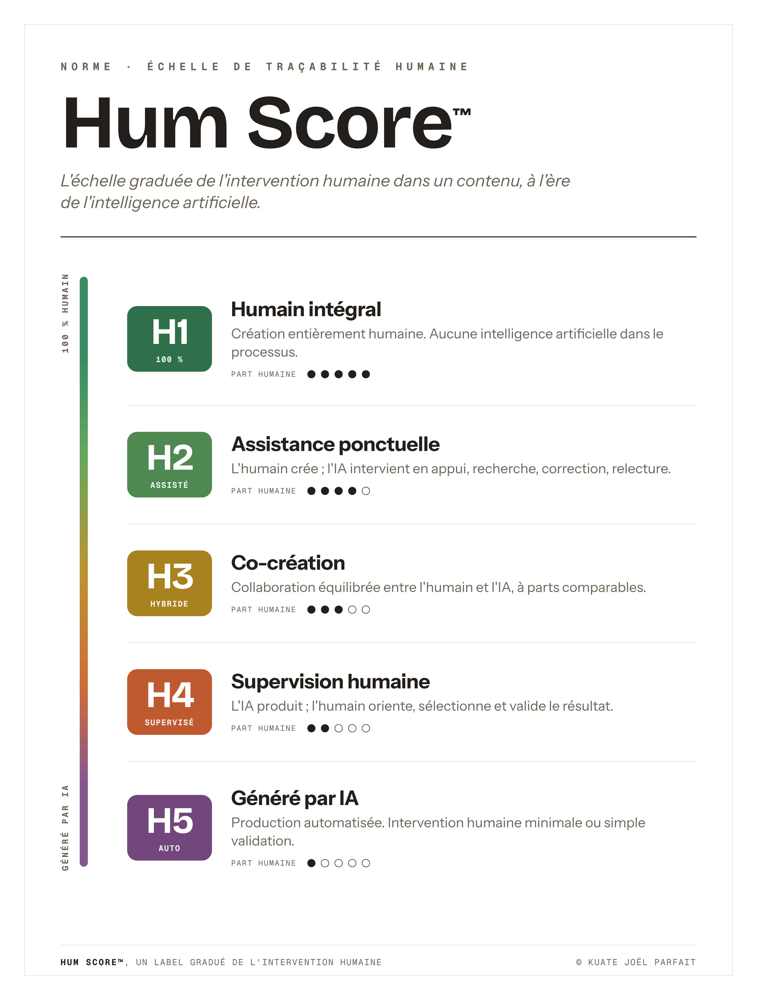
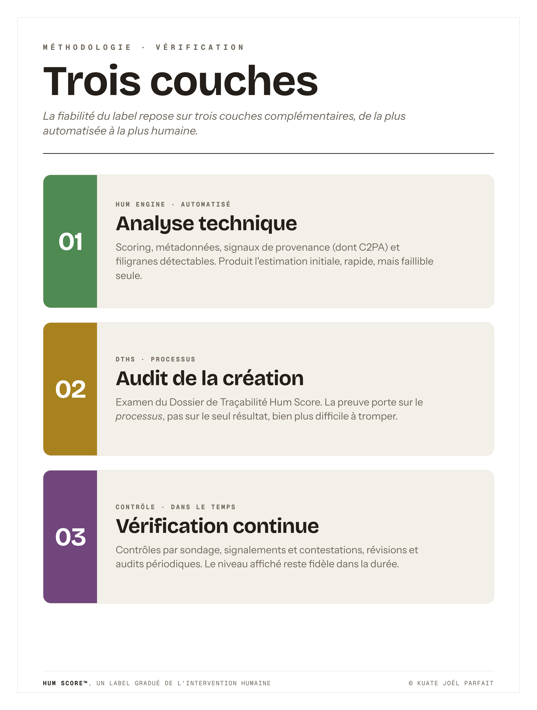
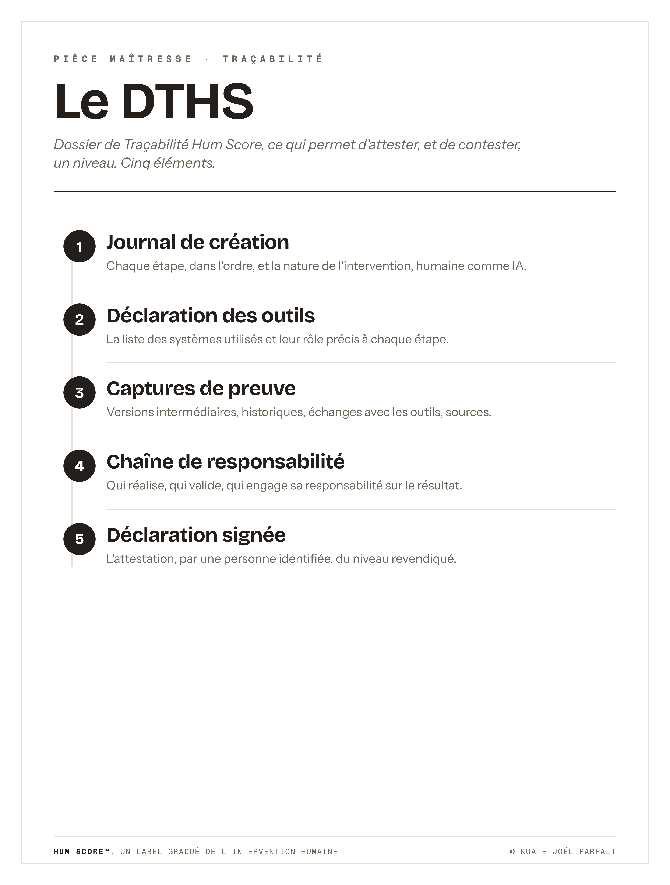

# Hum Score™

### Le standard ouvert et gradué de l'intervention humaine à l'ère de l'IA

*De H1 (100 % humain) à H5 (généré par IA) — lisible d'un coup d'œil, neutre, vérifiable.*

  

---

## Le problème

L'IA générative a effacé la frontière entre ce qu'un humain a fait et ce qu'une machine a produit. Les dispositifs existants — **C2PA / Content Credentials**, l'**article 50 de l'AI Act européen** (applicable depuis le 2 août 2026), les filigranes comme **SynthID** — répondent tous à la même question : *« est-ce de l'IA ? »*. Ils **marquent la machine**.

Personne ne répond à la question symétrique : **« quelle est la part humaine ? »**

## La réponse

Le **Hum Score™** est un label gradué, sur le modèle du Nutri-Score, qui mesure et affiche le **degré d'intervention humaine** dans un contenu ou un produit.

| Niveau | Nom | Part humaine | Rôle de l'IA |
|---|---|---|---|
| **H1** | Humain intégral | 100 % | Aucune IA générative |
| **H2** | Assistance ponctuelle | Majoritaire | Appui marginal (recherche, correction) |
| **H3** | Co-création | Équilibrée | Partenaire de création |
| **H4** | Supervision humaine | Minoritaire mais réelle | Producteur principal, dirigé par l'humain |
| **H5** | Généré par IA | Minimale | Producteur autonome |

> Le Hum Score™ **ne juge pas**. H1 n'est pas « bien », H5 n'est pas « mal ». Il informe sur un *degré*, pas sur une valeur.

## Ce qui le rend vérifiable

Une vérification en **trois couches** :

1. **Hum Engine** — analyse technique automatisée (scoring, métadonnées, provenance).
2. **DTHS** — Dossier de Traçabilité Hum Score : audit du *processus* de création.
3. **Contrôle continu** — sondages, signalements, révisions, audits.

Le tout scellé, pour la certification, dans le **Hum Ledger** (registre infalsifiable), et interrogeable via une **API de vérification en temps réel**.

## Un écosystème, pas un simple logo

- **Label gratuit** — la transparence pour tous (déclaratif).
- **Certification** — la confiance pour les enjeux forts (audité, scellé).
- **SaaS** — l'intégration dans la chaîne de production (API, gestion des DTHS).

## Ce dépôt

| Dossier | Contenu |
|---|---|
| [`whitepaper/`](whitepaper/) | Le livre blanc complet (Markdown + PDF) |
| [`spec/`](spec/) | La spécification normative et le modèle de DTHS |
| [`assets/plates/`](assets/plates/) | Les planches officielles (PNG + PDF) |

**Pour commencer :** lire le [livre blanc](whitepaper/hum-score-livre-blanc.md), puis la [spécification](spec/hum-score-specification.md).

## Statut et feuille de route

Spécification **ouverte v1.0**, publiée pour la critique et la contribution. Phases : label déclaratif → vérification outillée → registre & certification → interopérabilité (C2PA, AI Act). Détail dans le livre blanc.

## Contribuer

Les contributions sont bienvenues : critique de l'échelle, précision des règles d'attribution, cas d'usage sectoriels, interopérabilité technique. Voir [`CONTRIBUTING.md`](CONTRIBUTING.md) et [`GOVERNANCE.md`](GOVERNANCE.md).

## Licence et marque

Le **texte et les spécifications** de ce dépôt sont publiés sous **[Creative Commons Attribution 4.0 (CC BY 4.0)](LICENSE)** : réutilisation libre avec attribution. La dénomination **« Hum Score™ »**, son logo et son identité visuelle sont **réservés** afin de garantir l'intégrité du label (voir [`LICENSE`](LICENSE)).

## Auteur

**Kuate Joël Parfait** — consultant IA & stratégie, auteur, fondateur de Digital House Company.
Contact : hello@dhcompany.pro

---

<b>English summary</b>

**Hum Score™** is an open, graded standard for the **degree of human involvement** in content and products in the age of AI — from **H1 (fully human)** to **H5 (AI-generated)**, readable at a glance like a Nutri-Score. Existing frameworks (C2PA/Content Credentials, EU AI Act Art. 50, SynthID) *mark the machine* — they answer "is this AI?". Hum Score answers the symmetric question: *"how human is this?"*. It is neutral (no level is "better"), and verifiable through a three-layer method (Hum Engine scoring, the DTHS process-traceability dossier, and continuous control), sealed in the Hum Ledger. Specification text is CC BY 4.0; the "Hum Score™" name and identity are reserved. Contact: hello@dhcompany.pro.

